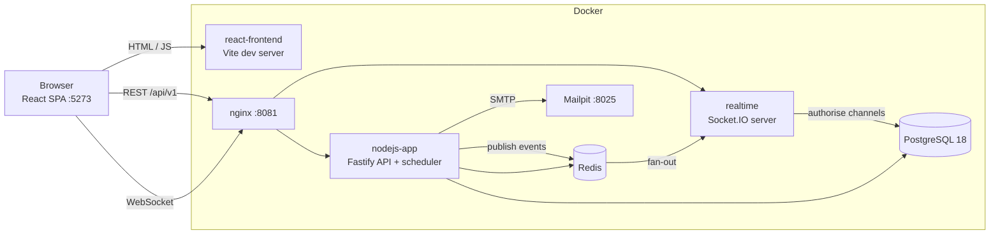

# Clinic & Shop Workspace

**One codebase, two branded products.** A full-stack, multi-tenant platform built with **Node.js 24** and **React 19** that serves a **medical clinic** app and an **online shop** app from the same API and the same single-page frontend.

Both products share authentication, role-based access control, team administration, real-time chat and branded bilingual emails. The theme decides the rest: menus, features, colours and email templates.


---

## Why this project

- **Two products, one codebase.** The tenant type (`doctor` or `marketplace`) picks the navigation, features, colour palette and email templates. You can run them as one multi-theme app or as separate standalone apps.
- **Fine-grained permissions.** 30 permissions in 10 groups. Roles are editable from the UI. The API enforces every permission, and the UI hides what you can't use.
- **Real-time team chat.** Rooms with audiences, presence, typing indicators, unread badges, and mute and lock moderation.
- **Production-minded.** Migrations run on boot, services have health checks, nginx proxies the websockets, and Redis handles caching, rate limits and fan-out.
- **No build step on the server.** Node 24 runs the TypeScript sources directly (type stripping); `tsc` only type-checks.
- **Well tested.** 121 backend tests (`node:test`) run against an in-process PostgreSQL, including real websocket tests.

---

## Features

### 🏥 Clinic (`doctor` theme)

- **Dashboard**: today's appointments, the waiting queue, check-ins and staff online.
- **Patients**: search, create, edit and archive.
- **Appointments**: book and reschedule. Status workflow: *scheduled → checked in → in progress → completed* (or *cancelled* / *no-show*).
- **Staff presence**: an on-duty switch with a heartbeat. Only staff marked online can check patients in.
- **Reports**: appointment totals by status and by reason over any period.

### 🛒 Shop (`marketplace` theme)

- **Dashboard**: stock levels, low-stock alerts, today's orders, pending orders and revenue.
- **Products**: catalogue with SKU, category, price, currency, stock and an active flag.
- **Orders**: stock-checked ordering. Status workflow: *pending → paid → shipped → delivered*. Cancelling an order returns its stock.
- **Insights**: best-selling products by units and by revenue.

### 💬 Live chat (both themes)

- Rooms for **everyone**, **admins only**, or **specific roles**. There's also an announcements room where only admins post.
- Live delivery, typing indicators, an online list per room, and unread badges.
- History loads as you scroll, drafts are saved per room, and missed messages are fetched again after a reconnect.
- **Moderation**: admins can mute anyone for a set time, in one room or in all rooms, and can lock a room. Members with the mute permission can mute non-admins.
- Room access is checked everywhere: REST endpoints, message history, and every websocket channel subscription.

### 🔐 Accounts & security

- Sign-up into the theme's workspace as a chat-only **Member**. An administrator then promotes them.
- JWT bearer tokens. Each token is backed by a database row, so it can be revoked.
- **Email verification** with signed links. The waiting page unlocks by itself once the link is opened, even on another device.
- **Password reset**. A reset signs out every device.
- Rate limits on login, the API, verification emails and chat messages.
- Each workspace's data is isolated: records of another workspace return 404.

### 👥 Administration

- **Team management**: invite members, edit them, assign roles and deactivate accounts.
- **Roles editor** with a grouped permission matrix. It includes safeguards: system roles can't be deleted, and the last administrator can't be removed.

### 🎨 Branding, languages & time zones

- Each theme has its own look: the clinic is blue, the shop is red and amber. The colours are applied to PrimeReact components at runtime, and the favicon is recoloured to match.
- **Branded emails** per theme, sent in the organization's name, with a plain-text version and an in-browser preview.
- **English and Greek** throughout: the UI, API messages, validation errors and emails.
- Dates are shown in each user's own time zone. They are stored in UTC.

---

## Tech stack

| Layer | Technology |
|---|---|
| **API** | Node.js 24 (native TypeScript), Fastify 5, Kysely, jose (JWT), bcrypt, nodemailer |
| **Realtime** | Socket.IO 4 with the Redis adapter and emitter |
| **Frontend** | React 19, TypeScript, Vite 8, React Router 7, zustand, PrimeReact 10, CSS Modules |
| **Data** | PostgreSQL 18, Redis 8 |
| **Infrastructure** | Docker Compose, nginx, Mailpit (local email inbox) |
| **Testing** | `node:test` + PGlite (in-process PostgreSQL) |

## Architecture



---

## Getting started

**Requirements:** Docker with Compose v2.

```bash
# 1. Configuration
cp .env.example .env                          # set POSTGRES_DB_PASSWORD
cp nodejs-app/.env.example nodejs-app/.env    # set APP_KEY (see below)

# Generate APP_KEY and paste it into nodejs-app/.env as  APP_KEY=base64:<value>
openssl rand -base64 32

# 2. Start everything
docker compose up -d --build --wait
```

| URL | What |
|---|---|
| http://localhost:5273 | The app |
| http://localhost:8081/api/v1 | REST API |
| http://localhost:8025 | Mailpit inbox (verification and password-reset emails) |

On first start, the database is migrated and filled with demo data. All demo accounts use the password **`password`**:

| Workspace | Email | Role |
|---|---|---|
| Acme Clinic | `admin@clinic.test` | Administrator + Doctor |
| Acme Clinic | `doctor@clinic.test` | Doctor |
| Acme Clinic | `reception@clinic.test` | Receptionist |
| Acme Market | `admin@market.test` | Administrator |
| Acme Market | `manager@market.test` | Store manager |
| Acme Market | `sales@market.test` | Sales associate |

To run the clinic and shop as **separate standalone apps** (ports 5274 and 5275):

```bash
docker compose --profile standalone up -d
```

To send email to real inboxes instead of Mailpit, put your SMTP server in the `MAIL_*` settings in `nodejs-app/.env`.

---

## Development

```bash
docker compose exec nodejs-app npm test               # backend tests
docker compose exec nodejs-app npm run type-check     # backend type-check
docker compose exec react-frontend npm run build      # frontend type-check + build
docker compose logs -f nodejs-app                     # API logs
```

The API and the realtime server reload by themselves when the code changes in development.

## Project structure

```
.
├── docker-compose.yml
├── configuration/          # Dockerfiles, nginx, postgres init
├── nodejs-app/             # Fastify API, Socket.IO server, migrations, tests
│   └── src/
│       ├── http/           # routes, validation, middleware
│       ├── services/       # auth, admin, chat, doctor, marketplace
│       ├── authorization/  # permission registry and ACL cache
│       ├── realtime/       # channels and Socket.IO server
│       └── mail/           # transports, branding, templates
└── react-frontend/src/
    ├── themes/             # clinic and shop pages
    ├── views/              # auth, admin, chat, settings
    ├── stores/             # zustand state
    └── locales/            # en.json, el.json
```

---

## Documentation

The full reference is in **[docs/DOCUMENTATION.md](docs/DOCUMENTATION.md)**. It covers:

- every configuration variable
- the permission matrix and system roles
- realtime channels and the API endpoint overview
- CLI commands and scheduled tasks
- design notes

## Before deploying to production

- Set `APP_ENV=production` and a fresh `APP_KEY`.
- Restrict `REALTIME_ALLOWED_ORIGINS` to your own hosts.
- Put a password on Redis.
- Serve everything over HTTPS.
- Change or remove the optional database role in `configuration/postgres/init.sql`.
- Never commit the `.env` files. Both are git-ignored.
