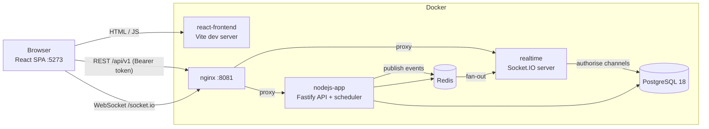

# Documentation: multi-theme clinic & shop platform

> The project overview is in the [README](../README.md). This page is the full reference.

One **Node.js 24** API and one **React 19** single-page app that serve two branded products from the same codebase:

- **Clinic** (`doctor` theme): patients, appointments, check-in with staff presence, reports.
- **Shop** (`marketplace` theme): products, stock, orders, sales insights.

Both share authentication, role-based access control, team administration, a real-time chat (Socket.IO) and branded, bilingual (English / Greek) emails. Everything runs with one `docker compose up`.

This is a port of the Laravel 13 + Vue 3 project with the same architecture, Docker stack, API contract and features. See [Differences from the Laravel version](#differences-from-the-laravel-version).

---

## Contents

- [Highlights](#highlights)
- [Architecture](#architecture)
- [Getting started](#getting-started)
- [Configuration](#configuration)
- [Features](#features)
- [API overview](#api-overview)
- [Project structure](#project-structure)
- [Development](#development)
- [Differences from the Laravel version](#differences-from-the-laravel-version)
- [Notes](#notes)

---

## Highlights

- **Two products, one codebase.** The tenant type (`doctor` / `marketplace`) picks the menu, the features, the colours, and the email templates.
- **One workspace per theme.** Everyone who signs up joins *Acme Clinic* or *Acme Market* as a chat-only **Member**; administrators promote them.
- **Fine-grained permissions.** 30 permissions in 10 groups, roles editable from the UI. The API enforces them, and the UI only hides what it can't use.
- **Real-time chat.** Rooms with audiences (everyone, admins only, specific roles), presence, typing indicators, unread badges, and mute and lock moderation.
- **Branded emails.** Verification and password-reset emails are designed per theme, sent as the organization, and written in the recipient's language.
- **Production-minded Docker stack.** Migrations run on every boot, there are health-checked service dependencies, and nginx proxies the websocket.
- **No build step on the server.** Node 24 runs the TypeScript sources directly (type stripping); `tsc` only type-checks.
- **Tested.** 121 backend tests (`node:test`) against an in-process PostgreSQL, including real websocket tests; strict TypeScript on both sides.

---

## Architecture



| Layer | Technology |
|---|---|
| API | Node.js 24 (native TypeScript), Fastify 5, Kysely (PostgreSQL), JWT access tokens (jose), bcrypt, nodemailer |
| Realtime | Socket.IO 4 with the Redis adapter / emitter; channel API modelled on Laravel Echo |
| Frontend | React 19, TypeScript, Vite 8, zustand, React Router 7, PrimeReact 10 (Lara, recoloured per theme), CSS Modules |
| Data | PostgreSQL 18, Redis 8 (ACL cache, rate limits, realtime fan-out) |
| Infra | Docker Compose, nginx, Node 24 (Alpine) |

### Docker services

| Service | Role | Host port |
|---|---|---|
| `react-frontend` | Vite dev server for the SPA | `5273` |
| `nginx` | Proxies the API and the websockets (`/socket.io/*`) | `8081` |
| `mailpit` | Catches every outgoing email (verification, password reset) in a web inbox | `8025` |
| `nodejs-app` | Fastify API. On boot it installs dependencies if needed, runs migrations, syncs permissions, seeds on first boot, and starts the API with its scheduler | – |
| `realtime` | Socket.IO server, built from the same image as `nodejs-app` | via nginx |
| `postgres` | Database | `5439` |
| `redis-alpine` | Redis | `6380` |
| `react-doctor`, `react-market` | Optional standalone single-theme frontends (`--profile standalone`) | `5274`, `5275` |

`nodejs-app` only reports *healthy* once migrations have succeeded and the API is listening, and nginx and the realtime server wait for that.

Container names, volumes and host ports all differ from the Laravel stack's, so **both stacks can run side by side** without sharing data.

---

## Getting started

**Requirements:** Docker with Compose v2.

1. Create the root `.env` from `.env.example` (read by `docker-compose.yml`) and set a database password. See [Configuration](#configuration).
2. Create `nodejs-app/.env` from `nodejs-app/.env.example` and set `APP_KEY` (`openssl rand -base64 32`, prefixed with `base64:`). Mail goes to the bundled **Mailpit** catcher by default (inbox at **http://localhost:8025**). To deliver to real inboxes, set your SMTP server in `MAIL_*`.
3. Start everything:

   ```bash
   docker compose up -d --build --wait
   ```

4. Open **http://localhost:5273**.

On first boot the database is migrated and seeded with demo data. Every demo account's password is `password`:

| Workspace | Email | Roles |
|---|---|---|
| Acme Clinic | `admin@clinic.test` | Administrator + Doctor |
| Acme Clinic | `doctor@clinic.test` | Doctor |
| Acme Clinic | `reception@clinic.test` | Receptionist |
| Acme Market | `admin@market.test` | Administrator |
| Acme Market | `manager@market.test` | Store manager |
| Acme Market | `sales@market.test` | Sales associate |

To also run the standalone clinic and shop frontends:

```bash
docker compose --profile standalone up -d
```

---

## Configuration

### Root `.env` (Docker Compose)

| Variable | Purpose |
|---|---|
| `POSTGRES_DB_HOST`, `POSTGRES_DB_PORT`, `POSTGRES_DB_HOST_PORT` | Database connection (`postgres`, `5432`, host port) |
| `POSTGRES_DB_DATABASE`, `POSTGRES_DB_USERNAME`, `POSTGRES_DB_PASSWORD` | Database name and credentials |
| `REDIS_HOST`, `REDIS_PORT`, `REDIS_HOST_PORT` | Redis |
| `HTTP_HOST_PORT`, `HTTP_PORT`, `APP_URL` | nginx (API and websockets) |
| `VITE_API_URL`, `VITE_PORT`, `FRONTEND_URL` | Where the SPA reaches the API (e.g. `http://localhost:8081/api`) and where it is served |
| `VITE_APP_THEMES`, `VITE_THEME_HOSTS` | Themes offered by the multi-theme SPA; theme per hostname |
| `TENANCY_THEMES` | Themes the backend serves (empty = all) |
| `AUTH_VERIFY_EMAIL` | Require email verification before using the app (`true`) |
| `FRONTEND_URL_DOCTOR`, `FRONTEND_URL_MARKETPLACE` | Only when the standalone frontends run: where emailed links point |
| `REALTIME_PUBLIC_URL` | Where browsers open the websocket (nginx) |
| `REALTIME_ALLOWED_ORIGINS` | Hosts allowed to connect (`*` in development) |

### `nodejs-app/.env` (API)

`APP_KEY`, `APP_ENV` (`local` enables the email previews), and `MAIL_*` (SMTP). Optional settings:

| Variable | Default |
|---|---|
| `TENANCY_DOCTOR_WORKSPACE` / `_NAME` | `acme-clinic` / `Acme Clinic` |
| `TENANCY_MARKETPLACE_WORKSPACE` / `_NAME` | `acme-market` / `Acme Market` |
| `TENANCY_WORKSPACE_TIMEZONE` | `Europe/Athens` |
| `AUTH_TOKEN_TTL_MINUTES` | `720` |
| `AUTH_VERIFICATION_TTL_MINUTES` | `1440` |
| `PRESENCE_TIMEOUT_MINUTES` | `5` |
| `PERMISSIONS_CACHE_TTL` | `3600` |
| `BCRYPT_ROUNDS` | `12` |

Docker passes the database, Redis, realtime and theme settings into the container, and those override `nodejs-app/.env`.

---

## Features

### Workspaces and sign-up

- **One workspace per theme.** Each theme has a single workspace, configured by slug: *Acme Clinic* (clinic) and *Acme Market* (shop). If a workspace is missing, it's created on demand together with its system roles.
- **Sign-up** asks for name, email, password and theme. The new user joins that theme's workspace as a **Member** (chat only), and the form says which workspace they're joining. An administrator then promotes them on the Team page.
- **Closed workspaces.** Sign-ups are refused while the workspace is deactivated.
- **Data isolation.** Every query of a tenant's data is scoped to the tenant resolved for the request, so records of another workspace are a 404.

### Authentication

- **Tokens.** Bearer JWTs (HS256, signed with `APP_KEY`, 12-hour lifetime by default), each backed by a revocable `access_tokens` row. The API never redirects.
- **Account endpoints:** login, sign-up, logout, current session (`/auth/me`), and profile (name, time zone, language, password).
- **Email verification.** The signed link opens the frontend of the account's theme. Until it's verified, the user can only reach their own session pages. Resending is rate-limited and reports mail outages clearly. The waiting page unlocks by itself once the link is opened in another tab, on another device, or when the tab regains focus.
- **Password reset.** The link is themed per account, and when the request comes from a standalone frontend it only acts on accounts of that theme. A reset signs out every device.
- **Rate limits** on authentication, the API, verification emails and chat messages.

### Roles and permissions

All permissions are defined in `nodejs-app/src/config/permissions.ts` and synced to the database on every boot. Administrators implicitly hold every permission available to their theme.

| Group | Permissions |
|---|---|
| Common | `users.*`, `roles.*`, `chat.view`, `chat.mute`, `chat.manage` |
| Clinic | `patients.*`, `appointments.*` (including `appointments.check-in`), `presence.toggle`, `reports.view` |
| Shop | `products.*`, `orders.view/create/update`, `marketing.view` |

System roles created for every workspace:

| Clinic | Shop | Access |
|---|---|---|
| Administrator | Administrator | Everything, including team and roles |
| Doctor | Store manager | Day-to-day work, plus `chat.mute` |
| Receptionist | Sales associate | Front-line work, chat |
| Member | Member | Chat only (self-registered users) |

Administrators can create custom roles from a permission matrix. System roles can't be deleted or have their admin flag changed. The last active administrator can't be removed or demoted. Permissions are cached per user and invalidated per workspace the moment roles change.

### Clinic

- **Dashboard:** today's numbers (scheduled, waiting, checked in, staff online) and the live visitor queue.
- **Patients:** search, create, edit and soft-delete.
- **Appointments:** booking, rescheduling and a status workflow (scheduled → checked in → in progress → completed, or cancelled / no-show), with the allowed transitions computed by the API.
- **Check-in** requires the staff member to be **online**.
- **Presence:** an online/offline (on-duty) switch with a heartbeat; stale sessions are closed by the scheduler every 5 minutes, and a "who's online" team view.
- **Reports:** appointment totals by status and by reason over a chosen period.

### Shop

- **Dashboard:** products, active products, units in stock, low-stock items, today's orders, pending orders and revenue, plus recent orders and a low-stock list.
- **Products:** catalogue with SKU, category, price, currency, stock and active flag.
- **Orders:** placing an order checks stock and currency; the status workflow is pending → paid → shipped → delivered, or cancelled (which returns the stock). Actions are colour-coded pill buttons, and cancelling asks for confirmation.
- **Insights:** best-selling products by units and revenue.

### Administration

Shared by both themes:

- **Team:** invite and edit members (new members get a verification email), assign roles and deactivate members.
- **Roles and permissions:** create and edit roles with a grouped permission matrix.

### Live chat

Real-time team chat on Socket.IO.

**Rooms**

| Room | Who can enter |
|---|---|
| **Global** (default) | Everyone in the workspace. It can't be deleted, and its audience can't be changed. |
| Announcements | Everyone reads; only administrators can post (locked room) |
| Admins | Administrators only |
| Doctors / Store managers | That role, plus administrators |
| Custom rooms | Everyone, admins only, or specific roles |

- **Room management.** Users with `chat.manage` create and edit rooms. Administrators can set any audience; other room managers can only open rooms to everyone or to roles they hold.
- **Access is enforced everywhere.** A room outside your audience is a 404 in the room list, the message history, the members list and by message ID. Its websocket channels refuse you too, so its messages never reach you.

**Messaging**

- Live delivery, typing indicators, and an online list per room through presence channels.
- Unread badges per room, and a total on the navigation link.
- History loads as you scroll up, messages are grouped by author and day, and there's a "new messages" jump button.
- Drafts are kept per room. Enter sends; Shift+Enter starts a new line.
- If the websocket drops, the page catches up after reconnecting and refreshes every 10 seconds in the meantime.

**Moderation**

- Administrators can mute **everyone**, other administrators included.
- Members holding `chat.mute` can mute **everyone except administrators**.
- Nobody can mute themselves.
- Mutes apply to one room or to all rooms, for 15 minutes, 1 hour, 24 hours, 7 days, or until lifted, with an optional reason. Muted members can still read.
- Administrators can **lock** a room, which mutes everyone except administrators.
- The same hierarchy decides who can delete someone else's message.

**Realtime channels**

| Channel | Carries |
|---|---|
| `private-chat.feed.{room}` | A room's messages (only its audience can join) |
| `presence-chat.room.{room}` | Who has the room open, and typing whispers |
| `private-chat.tenant.{id}` | Workspace signals (room changes, mutes) |

The browser connects with its bearer token (and the standalone theme); every `subscribe` is authorised by the realtime server against the database with the same rules as the API.

### Branded emails

- **Templates per theme.** Each theme has its own email verification and password reset templates (`nodejs-app/src/mail/templates.ts`), with a generic fallback for future themes.
- **Branding.** Each theme has its own colours and mark, set in `nodejs-app/src/config/branding.ts`. The organization's name is used as the sender name and in the content, and there's a plain-text version of every email.
- **Language.** Emails are written in the recipient's language: theirs, otherwise the workspace's (`nodejs-app/src/lang/{en,el}.ts`).
- **Preview without sending** (`APP_ENV=local` only): `http://localhost:8081/dev/mail/{verify-email|reset-password}/{doctor|marketplace}?lang=el&format=text`

### Themes, languages and time zones

- **Multi-theme app.** Guests choose a theme; signing in locks it to the account's workspace type.
- **Standalone apps.** Set `VITE_APP_THEME` or `VITE_THEME_HOSTS`. Each request then sends `X-App-Theme`, so sign-in and password reset only act on accounts of that theme.
- **Per-theme look.** Each theme has its own palette (clinic blue, shop red and amber), applied to PrimeReact's components at runtime, and a favicon recoloured to match.
- **Languages.** English and Greek throughout, in the UI, the API messages and the validation messages.
- **Time zones.** Each user's own, otherwise the browser's or the workspace's. The API stores UTC and returns ISO-8601 dates in the viewer's time zone.

---

## API overview

The API is versioned under `/api/v1` and is the same contract as the Laravel version. Responses are JSON, and errors carry a machine-readable `code` where it's useful (e.g. `chat_muted`, `email_unverified`). Validation failures are `422 { message, errors: { field: [...] } }`.

| Prefix | Endpoints |
|---|---|
| `GET /app` | Public bootstrap: served themes, workspace names, languages, features |
| `/auth` | `login`, `register`, `forgot-password`, `reset-password`, `email/verify/{id}/{hash}`, `me`, `logout`, `profile`, `email/resend` |
| `/admin` | `users`, `roles` (REST), `permissions` |
| `/doctor` | `dashboard`, `patients`, `appointments` (+ `check-in`, `status`), `presence` (+ `online`, `heartbeat`, `offline`, `team`), `reports/summary` |
| `/marketplace` | `dashboard`, `products`, `orders` (+ `status`), `insights/top-products` |
| `/chat` | `rooms` (+ `read`, `messages`), `messages/{id}`, `members`, `mutes` |

Websocket channel authorisation happens on the Socket.IO connection (`subscribe`), not over HTTP.

---

## Project structure

```
.
├── docker-compose.yml
├── configuration/
│   ├── app_conf/          # Node image (Dockerfile, entrypoint.sh: migrate on boot)
│   ├── frontend_conf/     # Node image for the SPA
│   ├── nginx/             # API + websocket proxy
│   └── postgres/          # init.sql
├── nodejs-app/
│   ├── src/
│   │   ├── server.ts / realtime.ts / cli.ts   # entry points (API, websockets, commands)
│   │   ├── app.ts                # Fastify app: hooks, error handling, routes
│   │   ├── config/               # env, permissions.ts, branding.ts
│   │   ├── db/                   # Kysely schema, migrations, migrator
│   │   ├── authorization/        # permission registry, ACL cache, sync
│   │   ├── tenancy/              # themes, workspaces
│   │   ├── services/             # auth, admin, chat, doctor, marketplace
│   │   ├── http/                 # middleware, validation, resources, routes
│   │   ├── realtime/             # channels, broadcaster, Socket.IO server
│   │   ├── mail/                 # transports, branding, templates
│   │   ├── lang/                 # en.ts, el.ts
│   │   ├── seeders/              # demo data
│   │   └── support/              # context, i18n, time, cache, rate limiter...
│   └── tests/                    # node:test suites (PGlite)
└── react-frontend/src/
    ├── api/               # typed HTTP client + endpoints
    ├── stores/            # auth, user, access, preferences, theme, presence, chat (zustand)
    ├── services/          # theme, realtime (Socket.IO)
    ├── router/            # routes, guard, route meta
    ├── hooks/             # notify, form errors, formatters, paginated lists...
    ├── themes/doctor|marketplace/   # theme-specific pages
    ├── views/             # auth, admin, chat, settings, errors
    ├── components/        # shared + chat components
    ├── config/            # navigation, editions (multi / standalone)
    └── locales/           # en.json, el.json (shared with the Vue app)
```

---

## Development

```bash
# Backend tests (in-process PostgreSQL, never touches the real database)
docker compose exec nodejs-app npm test

# Backend type-check
docker compose exec nodejs-app npm run type-check

# Frontend type-check and production build
docker compose exec react-frontend npm run type-check
docker compose exec react-frontend npm run build

# Migrations (also run automatically on every container start)
docker compose exec nodejs-app node src/cli.ts migrate

# Re-sync permissions (also on every start); --roles resets system roles to config
docker compose exec nodejs-app node src/cli.ts permissions:sync

# Demo chat rooms and messages (idempotent)
docker compose exec nodejs-app node src/cli.ts db:seed --class=ChatDemoSeeder

# Logs
docker compose logs -f nodejs-app
docker compose logs -f realtime
```

- **Scheduled tasks:** `presence:close-stale` every 5 minutes, and `tokens:purge` daily, run by the API process. A PostgreSQL advisory lock keeps several API replicas from running the same task at once. Both can also be run by hand with `node src/cli.ts`.
- **Live reload:** in development (`APP_ENV` other than `production`) the API and the realtime server restart on source changes (`node --watch`).
- **When to restart the realtime server:** only after changing its environment (`docker compose restart realtime`); code changes reload by themselves in development.

---

## Differences from the Laravel version

Same features, API contract, permissions, rules and demo data. Where the stack differs:

| Laravel / Vue | Node.js / React |
|---|---|
| Laravel 13, PHP-FPM | Fastify 5 on Node.js 24, TypeScript run natively |
| Eloquent + global tenant scope | Kysely; every query passes the request's tenant explicitly (no hidden global state) |
| FormRequest validation | A small validator with Laravel's semantics (`sometimes`, `nullable`, `field.*`, `exists`, `unique`...) and its message format |
| Passport personal access tokens | Signed JWTs whose `jti` is a revocable `access_tokens` row |
| Reverb + Laravel Echo (Pusher protocol) | Socket.IO server + Redis; the frontend's realtime service keeps Echo's API (`private`, `join`, `here`, `whisper`...) |
| `POST /api/v1/broadcasting/auth` | Channel authorisation on `subscribe` over the socket |
| Pest on in-memory SQLite | `node:test` on in-process PostgreSQL (PGlite): real Postgres semantics |
| Vue 3, Pinia, vue-i18n, PrimeVue 4 (Aura) | React 19, zustand, a vue-i18n-compatible translator (same locale files), PrimeReact 10 (Lara) |
| Scoped `<style>` | CSS Modules |
| Database queue worker | None: like the Laravel version, mail is sent during the request and chat events are published immediately, so the queue had no work |

Deliberate changes:

- **Bug fix, last-admin guard:** Laravel locked the admin count with `count(*) … FOR UPDATE`, which PostgreSQL rejects with an aggregate, so demoting or deactivating an administrator errored on Postgres. The Node version locks the rows, then counts.
- **Rate limits by real client IP:** the API trusts nginx's `X-Forwarded-For` (`TRUSTED_PROXIES`), so per-IP limits apply per client rather than to the proxy's address.
- **Permission before lookup:** a route checks the permission before loading the record, so someone without access gets 403 without learning whether an ID exists (Laravel bound the model first).
- **Validation and password-reset messages in Greek too** (Laravel fell back to English for those).
- **Malformed IDs** (`/patients/abc`) are a 404 instead of a database error.
- **Not ported:** the one-off `consolidate_workspaces` data migration (and its test), which only merged organizations left over from an earlier sign-up flow, and the unused Vue stubs (`Notification`, `Popover`, `Profile`, `types/auth`).
- **Ports and names:** host ports 8081 / 5273 / 5439 / 6380 and `nodejs-*` container and volume names, so both stacks can run at the same time.

---

## Notes

- **Before going to production:** set `APP_ENV=production` and a fresh `APP_KEY`, restrict `REALTIME_ALLOWED_ORIGINS`, put a password on Redis, serve everything over HTTPS, and review `npm audit`.
- **Never commit the `.env` files:** they hold the database password, `APP_KEY` and SMTP credentials (both are git-ignored).
- **`configuration/postgres/init.sql`** creates an optional extra database role with a fixed password, as in the Laravel stack. Change or remove it before deploying.
